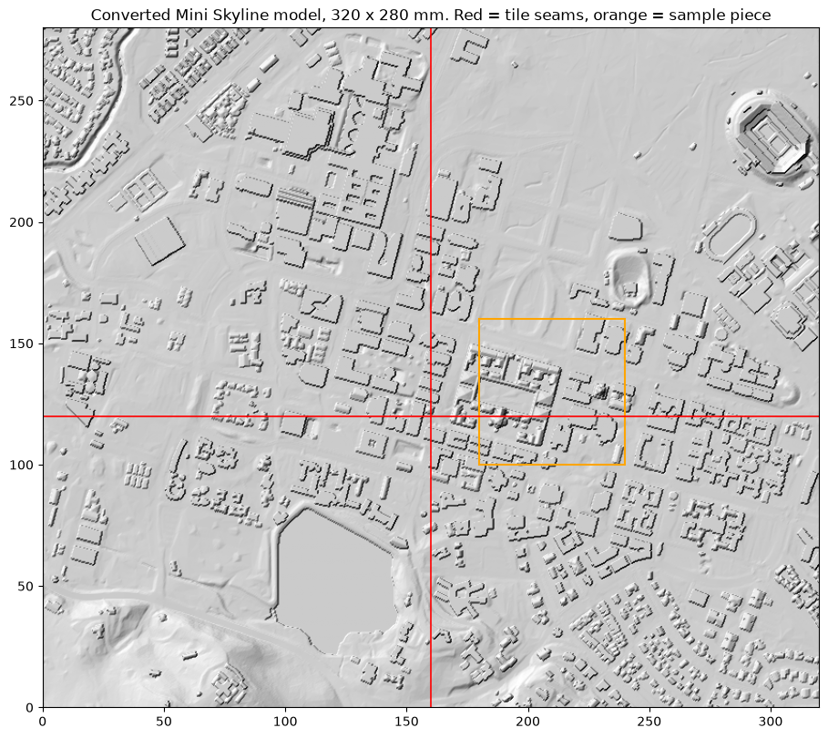
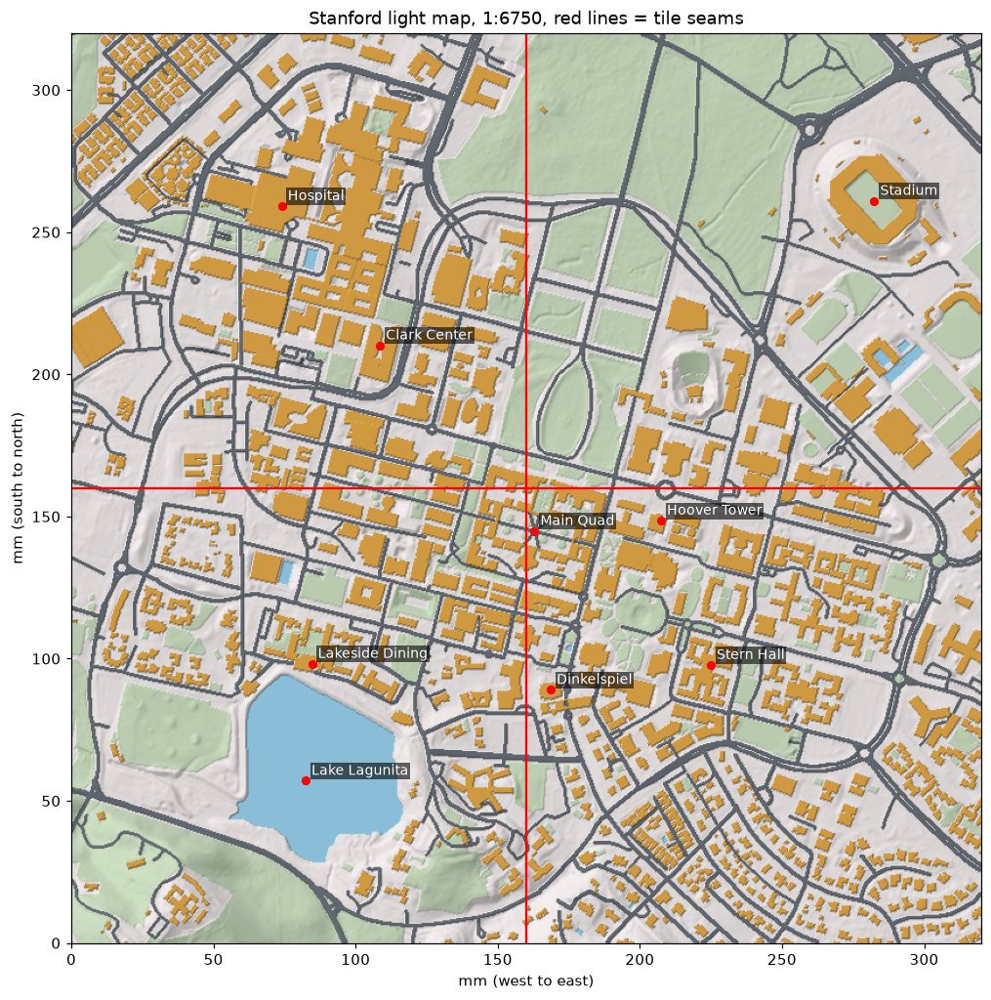

# Find My Stanford Map

A 3D-printed map of Stanford that sits on an LED grid. Each light shows where a friend is.



The map is a thin white shell over 32x32 LEDs. Walls underneath keep each LED's light in its own 10 mm cell.

## View it in 3D

- [Whole map](models/miniskyline_whole_map.stl)
- [60 mm sample](models/miniskyline_sample_60mm.stl) (flip it to see the LED cells)

## Build

```sh
python3 -m venv .venv
.venv/bin/pip install -r requirements.txt
.venv/bin/python build_terrain.py                  # terrain from USGS + OpenStreetMap
.venv/bin/python build_terrain.py --layers         # same, plus roads, water and lawns
.venv/bin/python -I convert_3mf.py model.3mf       # or convert a Mini Skyline model
```

Printable tiles are written to `~/Documents/stanford-lightmap`.

`--layers` gives a Maps3D-style map: roads stand 0.4 mm up, lawns 0.2 mm up, and water sits 0.6 mm down.



## Credits

USGS 3D Elevation Program, © OpenStreetMap contributors (ODbL), and [Mini Skyline](https://miniskyline.com) ([full attribution](models/MINISKYLINE_ATTRIBUTION.txt)).
