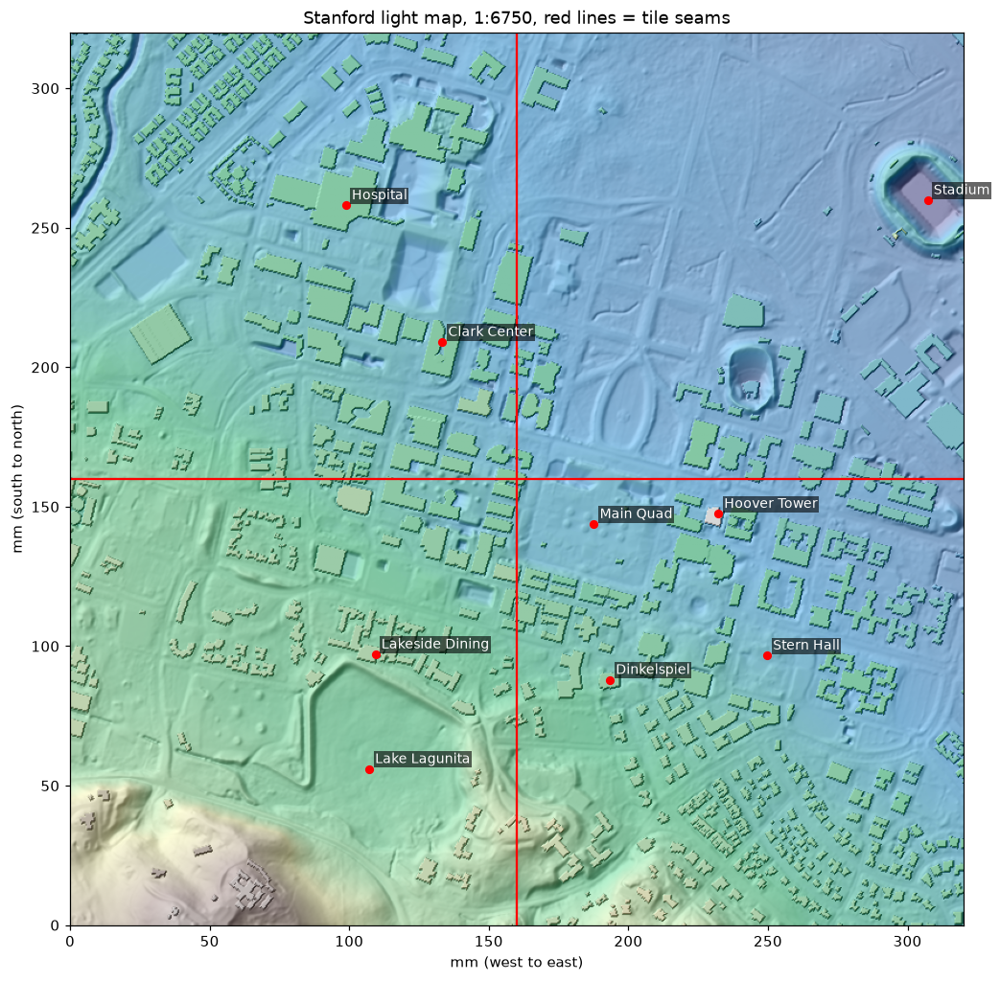

# Find My Stanford Map

A 3D-printed terrain map of Stanford campus that sits on an LED matrix. Each LED lights up where a friend is.



## Status

- [x] Terrain tiles (this repo)
- [ ] Location feed from Find My
- [ ] LED controller (ESP32 running WLED)

## The model

- 2.16 km square at 1:6,750 covering core campus: hospital to Stadium in the north, Lake Lagunita in the south.
- Four 160 mm tiles. Each one sits on a 16x16 WS2812B panel (10 mm pitch), so the full map is 32x32 LEDs at 67.5 m per LED.
- Each tile is a 1 mm translucent skin held up by 0.8 mm walls on the LED pitch. The walls support the skin while printing and keep each LED's light in its own cell.
- Height is exaggerated 2x because campus is nearly flat.
- Elevation comes from USGS 3DEP lidar. Buildings come from OpenStreetMap.

## Build

```sh
python3 -m venv .venv
.venv/bin/pip install -r requirements.txt
.venv/bin/python build_terrain.py   # writes STLs to ~/Documents/stanford-lightmap
.venv/bin/python preview.py         # writes preview.png next to them
```

Outputs: `tile_NW.stl`, `tile_NE.stl`, `tile_SW.stl`, `tile_SE.stl`, `test_coupon.stl`, and `map.json` (the GPS-to-LED mapping).

Print `test_coupon.stl` first. It has four cells with 0.6, 0.8, 1.0 and 1.4 mm skins. Pick the one that glows best over an LED, set `SKIN_MM` in `build_terrain.py`, and rebuild.

All the knobs (map centre, size, exaggeration, wall and skin thickness) are constants at the top of `build_terrain.py`.

## Data credits

- Elevation: U.S. Geological Survey 3D Elevation Program.
- Buildings: © OpenStreetMap contributors, ODbL.
